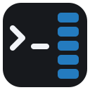
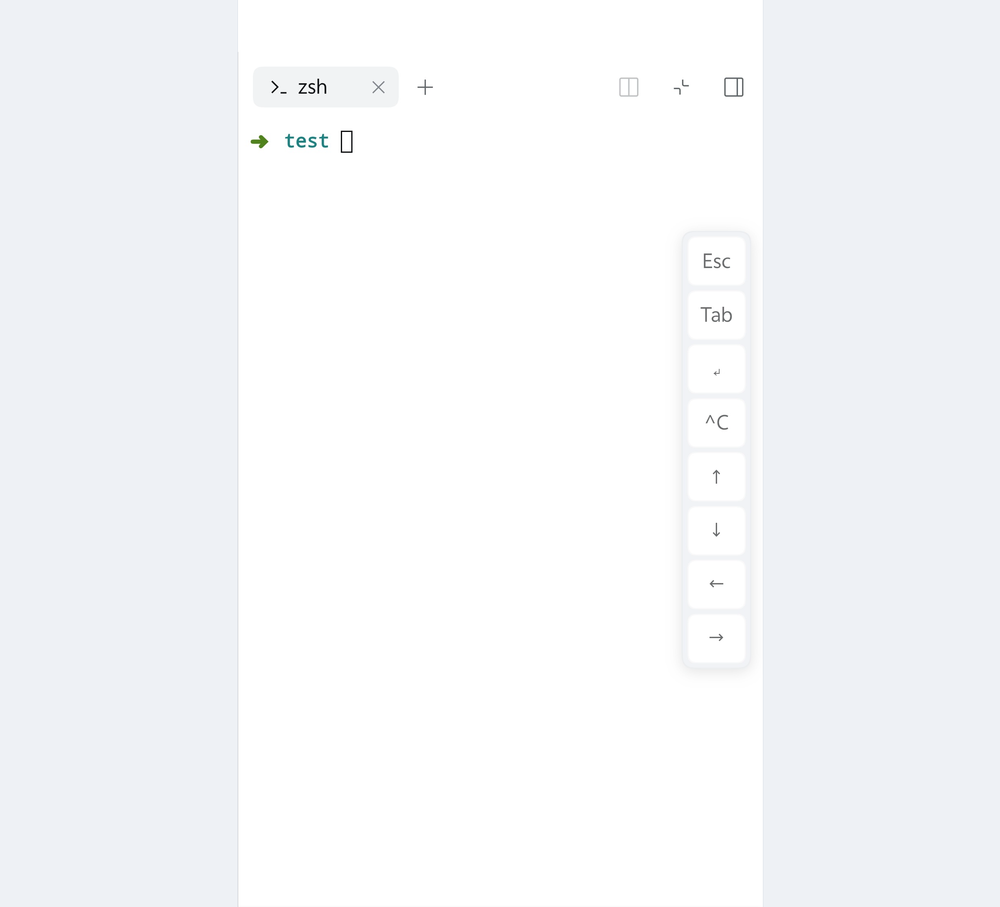

# dsh-terminal-keybar

**English** | [中文](README.zh.md)

A **touch key bar for the DSH Web terminal**. A phone's soft keyboard has no Escape,
Tab, Ctrl or arrow keys, which makes the terminal unusable. This plugin floats a
translucent column of those keys on the right edge of the screen and writes them
straight into the terminal that is on screen.

- Vertical, translucent, so it does not cover the bottom of the terminal
- Appears only on **touch devices** and only while a **terminal tab is active**; desktop is untouched
- Centres itself in the **visible** area when the soft keyboard opens, so iOS does not hide it
- A browser-only plugin: it copies no terminal code and does not modify DSH itself



## Screenshots



## Keys

| Button | Sends | Typical use |
|---|---|---|
| `Esc` | `\x1b` | leave vim insert mode, close less/pagers |
| `Tab` | `\t` | path and command completion |
| `↵` | `\r` | run the command |
| `^C` | `\x03` | interrupt the running command |
| `↑` `↓` | `ESC [ A` / `ESC [ B` | history, menu navigation, vim movement |
| `←` `→` | `ESC [ D` / `ESC [ C` | move within the line |

Presses use `pointerdown` + `preventDefault()`, so the terminal keeps focus and the
soft keyboard stays open: you can type and tap arrows in the same session.

## Install

### 1. Through the Host's `installBundle` (installs **and** enables)

Ask the agent in a conversation:

> install the plugin `github:miiy/dsh-terminal-keybar`

or paste the same spec into the install field on the **Settings → Plugins** page.

Both call the Host's `installBundle`, which installs the package, adds it to
`dsh.profile.bundles`, and hot-applies it — one step.

### 2. From the CLI (`dsh plugin`, installs only)

```sh
dsh plugin --profile <profile> add github:miiy/dsh-terminal-keybar
```

`dsh plugin` forwards its arguments to pnpm inside the profile directory, so this step
installs the package but does **not** compose it. The row then shows up on
**Settings → Plugins** as installed and switched **off**; turn it on to add it to
`dsh.profile.bundles`. If the switch does not take effect live, restart `dsh web`.

A plain-JavaScript bundle has no build script, so a git install needs no `allowBuilds`
approval.

Accepted spec forms are the usual pnpm/DSH ones: `github:user/repo`, `git+https://…`,
an absolute local path, or an npm package name.

### 3. From a local checkout (development)

```sh
plugin_manager install_bundle /absolute/path/to/dsh-terminal-keybar
```

## Usage

1. Open DSH Web on your phone.
2. Open a terminal tab in the right sidebar.
3. The key column appears on the right edge; tap it. It also works with the keyboard closed.

## Known limitations

- **DECCKM (application cursor keys)**: the plugin writes bytes through the public
  `webTerminals` service and has no access to the xterm instance, so the arrows always
  send the CSI form (`ESC [ A`). bash/readline, vim and less accept it; programs that
  strictly require SS3 (`ESC O A`) may not.
- **Floating panels**: visibility is decided from the active pane's active tab, so a
  terminal floated into a floating panel does not show the bar.
- The column covers roughly the rightmost 46px of the terminal; it is translucent, and
  `styles.bar` in `client.js` exposes `opacity` / `right` if you want it smaller.
- Web only (`platform: web`); the Desktop native window is unaffected.

## Maintenance

See [MAINTENANCE.md](MAINTENANCE.md) for the upstream API table (what breaks when DSH
changes what) and the post-upgrade diff procedure. The `DEBUG` switch at the top of
`client.js` paints an on-screen diagnosis badge when the bar does not appear.

```sh
node --check client.js && node --check index.js   # syntax self-check
```

## License

MIT
